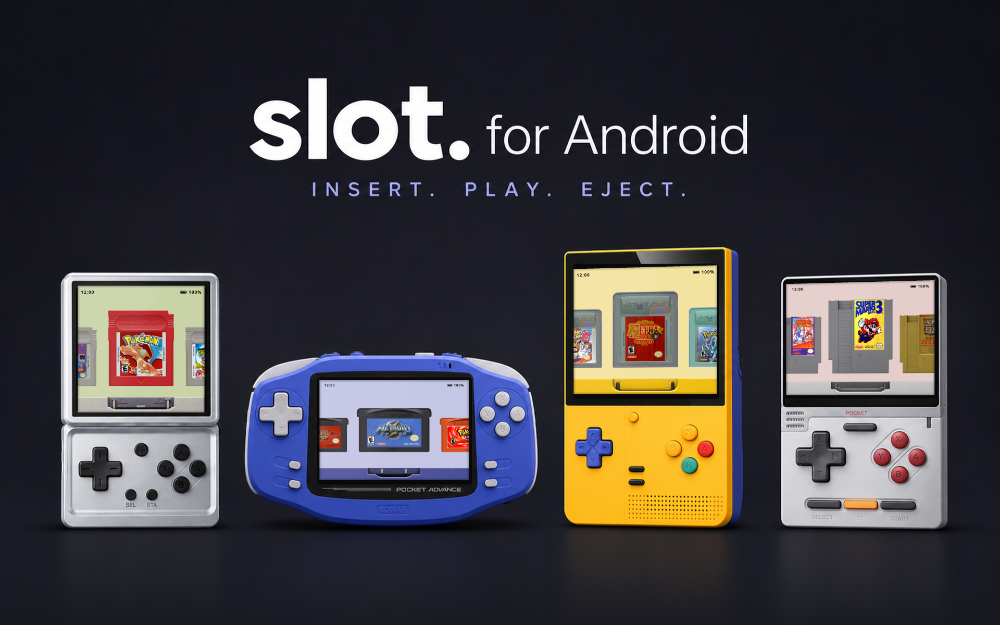

# slot. for Android

An unofficial Android port of [slot.](https://slot-cfw.fyi/#hero). Your games appear as cartridges on a shelf: pick one, insert it and play.

**[Download the latest version](https://github.com/Baggio94/slot-for-android/releases/latest)** · **[Read the guide](https://github.com/Baggio94/slot-for-android/wiki)**

## Why I made this port

When I watched [Russ from Retro Game Corps showcase slot.](https://www.youtube.com/watch?v=vndbnpH0QoE&t=1167s), I thought it would be perfect for the KONKR Pocket Advance, a handheld I mostly use for Game Boy Advance games.

The round button on top of the KONKR fits slot. naturally: press it to insert a cartridge, hold it while playing to eject it. It feels close to handling a real cartridge.

The port has since grown to other Android handhelds and more systems. The goal stays the same as the original: less time in menus, more time playing.

## Highlights

- **Cartridges first.** Your library is a shelf of cartridges with their real labels, insertion and ejection animations and sounds.
- **Themes.** Dark, OLED, Light and Original, with a wallpaper for each shelf.
- **Six systems.** Game Boy, Game Boy Color, Game Boy Advance, NES, Super Nintendo and Mega Drive, each with two emulation cores to choose from.
- **Any screen shape.** The interface adapts to square, 4:3, 3:2 and widescreen handhelds at their native resolution, including the Anbernic RG Rotate.
- **Cart Studio.** Change a cartridge's label, shell colour, finish and shape, right on the handheld.
- **Screen options.** LCD and CRT shaders, overlays, color correction, Frame Blending and LCD effects, per system or per game.
- **Your games on every handheld.** The slot. folder carries your saves, states, labels, favorites and settings from one handheld to another, on an SD card or synced storage.
- **Saves.** Save states, automatic saving on eject, rewind and fast-forward. Compatible with RetroArch saves and Syncthing, and synced with your RomM server if you like.
- **RetroAchievements.** Online or offline, with unlocks synced when you reconnect.
- **Multiplayer.** Link Cable, Wireless Adapter and two-player netplay, on the same Wi-Fi or over the Internet.
- **RomM.** Download games, BIOS files and saves from your own RomM server.
- **Cheats.** RetroArch's cheat database is included for every system.

## Getting started

1. Download the APK from [Releases](https://github.com/Baggio94/slot-for-android/releases/latest) and install it. It needs an ARM64 handheld with Android 12 or later.
2. Open slot., press **START → Library → Choose ROM Folder** and pick your parent ROM folder (not `gba`, `gb`...).
3. Pick a cartridge and press **A**.
4. Optional: press **START → Library → Choose slot. Folder** to keep slot.'s data in a folder you can back up or take to another handheld.

Supported files: `.gba`, `.gb`, `.gbc`, `.nes`, `.fc`, `.unf`, `.unif`, `.sfc`, `.smc`, `.md`, `.gen`, `.smd`, `.bin`, and `.zip` archives with one game each. Games can sit directly in that folder or in one subfolder per system (ES-DE style).

**Updating:** slot. checks for updates in **START → About**. You can also install a newer APK over the current one. Don't uninstall slot. or clear its data first, or you will lose your settings and the saves stored inside the app. With a slot. folder, they are safe in that folder.

More in [Getting Started](https://github.com/Baggio94/slot-for-android/wiki/Getting-Started).

## Essential controls

The KONKR's round top button is the **slot. cap**. On a Retroid Pocket, it's the round centre key. On the Anbernic RG Rotate, it's the middle button.

| Button | Action |
|---|---|
| slot. cap or **A** | Insert a cartridge |
| Hold the slot. cap or **A** (on the shelf) | Start the game fresh, without its save state |
| Tap the slot. cap or **SELECT + X** | Open the game menu |
| Hold the slot. cap or **SELECT + START** | Save and eject |
| **SELECT + Y** | Screen menu (shader, overlay, screen size) |
| **START** (on the shelf) | Main menu |
| **SELECT** (on the shelf) | Choose the core for a game |

On a touchscreen: swipe through the carts, tap or pull down the middle cart to insert it, push it up to choose its core, hold a cart to open it in Cart Studio.

Every shortcut can be changed in **START → Settings → Controls → Hotkeys**. The full list is in [Controls & Hotkeys](https://github.com/Baggio94/slot-for-android/wiki/Controls-and-Hotkeys).

## Guide

The [wiki](https://github.com/Baggio94/slot-for-android/wiki) explains every screen and setting:

- [Getting Started](https://github.com/Baggio94/slot-for-android/wiki/Getting-Started) · [Controls & Hotkeys](https://github.com/Baggio94/slot-for-android/wiki/Controls-and-Hotkeys) · [Shelves](https://github.com/Baggio94/slot-for-android/wiki/Shelves) · [Game Menu](https://github.com/Baggio94/slot-for-android/wiki/Game-Menu)
- [Settings](https://github.com/Baggio94/slot-for-android/wiki/Settings) · [Screen, Shaders & Effects](https://github.com/Baggio94/slot-for-android/wiki/Screen-Shaders-and-Effects) · [Cores & Saves](https://github.com/Baggio94/slot-for-android/wiki/Cores-and-Saves) · [slot. Folder](https://github.com/Baggio94/slot-for-android/wiki/slot.-Folder)
- [Cart Studio](https://github.com/Baggio94/slot-for-android/wiki/Cart-Studio) · [RomM](https://github.com/Baggio94/slot-for-android/wiki/RomM) · [RetroAchievements](https://github.com/Baggio94/slot-for-android/wiki/RetroAchievements) · [Multiplayer](https://github.com/Baggio94/slot-for-android/wiki/Multiplayer) · [Cheats](https://github.com/Baggio94/slot-for-android/wiki/Cheats)
- [Special Games](https://github.com/Baggio94/slot-for-android/wiki/Special-Games) (Boktai, motion games) · [Apps & Home Launcher](https://github.com/Baggio94/slot-for-android/wiki/Apps-and-Home-Launcher)
- Handhelds: [KONKR Pocket Advance](https://github.com/Baggio94/slot-for-android/wiki/KONKR-Pocket-Advance) · [Retroid Pocket Classic](https://github.com/Baggio94/slot-for-android/wiki/Retroid-Pocket-Classic) · [RG Rotate](https://github.com/Baggio94/slot-for-android/wiki/RG-Rotate)

## Credits & License

Thanks to **[Brandon Kowalski](https://github.com/BrandonKowalski/slot)**, creator of the original [slot.](https://slot-cfw.fyi/), **[Markus](https://github.com/MarkusMaribu)** for its artwork, and to the authors of the emulation cores, shaders, overlays and tools slot. for Android uses. The full list is on the [Credits](https://github.com/Baggio94/slot-for-android/wiki/Credits) page.

This is an unofficial community port, not affiliated with or endorsed by the original Slot developers or any handheld manufacturer. The Slot-derived source code is distributed under the [GNU GPL-3.0](LICENSE). Third-party components keep their own licenses, listed in [licenses](licenses).
